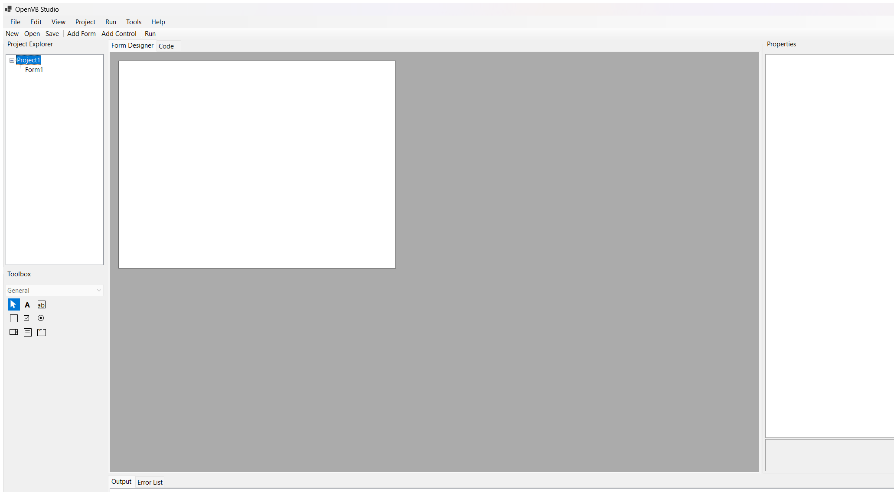

# OpenVB Studio

OpenVB Studio is an early, open-source Windows Forms IDE prototype inspired by classic Visual Basic. It is not a full VB6-compatible environment.

## Screenshot



## Requirements

- Windows 10 or Windows 11, x64
- .NET 10 SDK
- Visual Studio 2022 or a recent Visual Studio Code C# setup

## Build and run

From the repository root:

```powershell
dotnet build OpenVBStudio.sln
dotnet test OpenVBStudio.sln
dotnet run --project OpenVBStudio.IDE
```

The IDE includes a project explorer, a classic-style icon-grid toolbox, form designer, property grid, BASIC code editor, output pane, and error list. Hover over a toolbox icon to see its name, then click it and click the form to place that control at the clicked position. The toolbox automatically returns to Pointer after each placement; select another control icon to place that type next. Drag a selected control to move it, or drag its lower-right corner to resize it. Double-click a CommandButton to create or open its `*_Click` procedure. Run the project and click the button to execute that procedure.

Use **Project → Menu Editor** to add top-level menus and nested items, edit each item's Caption, Name, Enabled, and Visible properties, or remove selected items. Double-click the menu preview on the form to open the editor. Menu layout is saved with the form. At runtime, menu item clicks invoke a matching BASIC procedure such as `FileExit_Click` for a menu named `FileExit`.

To display another project form from a button event, first add `Form2` using **Project → Add Form**, then put this in the button's Click procedure on `Form1`:

```vb
Private Sub Command1_Click()
    Form2.Show
End Sub
```

Replace `Command1` and `Form2` with the actual control and form names. The target form must exist in the current project.

Projects are JSON documents with the `.ovbproj` extension. They store project/form names, form dimensions, control type and bounds, common control properties, nested menu items, and form source code. The serializer uses camel-case JSON properties. A project can contain multiple forms; the current Run command launches the active form.

Supported controls are Form, Label, TextBox, CommandButton, CheckBox, OptionButton, ComboBox, ListBox, and Frame. In a running button event, use `MsgBox Text1.Text` to show the current TextBox contents, or access supported properties such as `Label1.Caption`, `.Enabled`, and `.Visible`. Current BASIC support includes declarations for String, Integer, Long, Boolean and Variant, assignments, arithmetic and string expressions, If/Else, For/Next, Do/Loop, Sub, Function, procedure calls and MsgBox. The interpreter uses a loop execution limit as a safety guard. Unsupported VB6 syntax and semantics are not implied to work.

## Solution structure

- `OpenVBStudio.Core` — JSON project model and service, plus separate BASIC lexer, parser, semantic checks, and interpreter.
- `OpenVBStudio.IDE` — Windows Forms IDE and designer/runtime integration.
- `OpenVBStudio.Tests` — automated tests for project persistence, parsing diagnostics, and interpreter execution.
